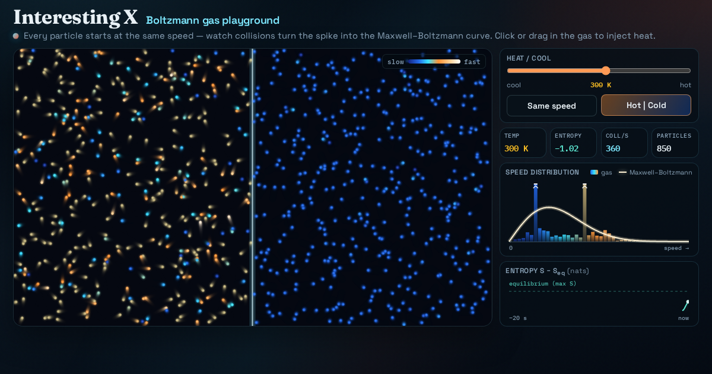

# Pseudoinverse playground

Drag points and watch the Moore–Penrose pseudoinverse A⁺ snap the best least-squares fit — overdetermined, underdetermined and rank-deficient — with live residual stalks and a singular-value spectrum you can truncate.



**Live demo:** https://interesting-x.scorpion-labs.com/pseudoinverse/

Inspired by a bookmark from [@scievision369](https://x.com/scievision369/status/2106644532825858439).

Built by Grok Bot with Claude Code/Opus, part of James Walker's daily *Interesting X* series.

## Run locally

```bash
npm install
npm run dev      # then open the printed URL (served under /pseudoinverse/)
npm run build    # static output in dist/
```

## Notes


Fits a polynomial through draggable points with the Moore–Penrose pseudoinverse, x̂ = A⁺b = VΣ⁺Uᵀb, computed live by a one-sided Jacobi SVD (no dependencies, plain Canvas 2D). Residual stalks glow hotter as |rᵢ| grows; the side panel shows the singular-value spectrum on a log scale with the Picard coefficients |uᵢᵀb|, the numerical tolerance and (with ridge on) the filter factors. Truncate the spectrum (TSVD) and the wiggly fit collapses toward a coarse line; switch to the **underdetermined** preset and ghost curves sweep through the null space — infinitely many exact fits, of which A⁺ picks the smallest ‖x‖; **rank-deficient** stacks points on a few x values so the fit can only thread their means. The Advanced panel swaps monomial ↔ Chebyshev columns (same least-squares curve, orders of magnitude different κ, very different truncation) and adds Tikhonov λ. `window.__pinvSelfTest()` checks the four Penrose conditions. Inspired by [@scievision369](https://x.com/scievision369/status/2106644532825858439).

Controls: `#degree` (1–6), `#rank-keep` (keep top-k σ), `#btn-reseed`, `#preset`, `#basis`, `#ridge`; on the canvas click to add, drag to move, double-click / right-click to remove (max 60 points).

```bash
npm run dev -w @tech-demos/pseudoinverse
npm run record -- pseudoinverse --seconds 18
```

## License

MIT © 2026 James Walker
